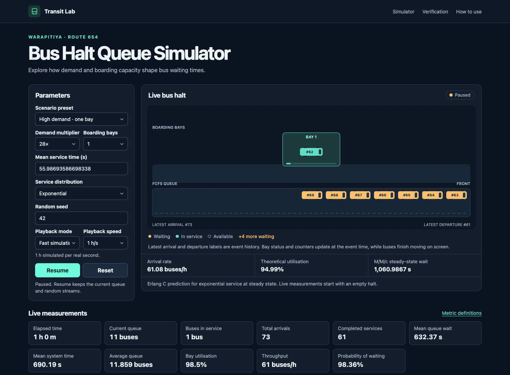
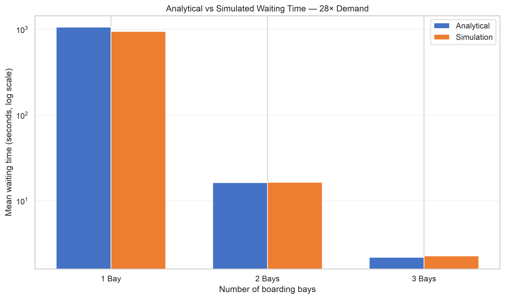

# Bus Halt Queue Simulator

A reproducible queueing study and offline browser simulator for exploring how additional boarding bays affect bus waiting under different demand levels.

**[Live demo on GitHub Pages](https://sandalika-gunawardhana.github.io/bus-halt-queue-simulator/)**

## Problem and research question

A bus that arrives when all boarding bays are occupied must wait. An extra bay can shorten that queue, but it also takes up space and may be rarely used at low demand.

How does increasing capacity from one bay to two or three change average bus waiting time, queue length and bay utilisation as demand rises? The model uses observations from Warapitiya on Sri Lanka’s Kandy–Digana Route 654 to calibrate a hypothetical halt. Higher demand levels are stress tests.

## Quick start

- **Notebook:** Open the Colab badge and choose **Runtime → Run all**. The [notebook](notebook/bus-halt-queue-simulator.ipynb) installs its additional dependencies, downloads dataset version 2 through KaggleHub, and verifies the original SHA-256 checksums of all three inputs before reading them. A fresh Colab CPU run was observed at approximately one minute. Timing depends on the runtime and download.
- **Browser demo:** Open the live demo above, or download or clone the full repository and double-click `docs/index.html`. Keep the HTML, CSS and JavaScript files together. The local demo runs offline without a backend, build step or package installation.

## Using the demo

Choose a preset and start the simulator. Use Visual mode to follow individual buses or Fast simulation to compare runs over several simulated hours. Compare one and two bays with the same demand, seed and simulated duration. The [user guide](USER_GUIDE.md) explains the controls, live metrics and verification button.

## Model and mathematics

Poisson arrivals feed a shared first-come, first-served queue with one to three identical bays. The primary M/M/c model uses exponential service. A mean-matched lognormal alternative tests the effect of service variability. With arrival rate $\lambda$, service rate per bay $\mu$, and $c$ bays, offered load per bay is $\rho=\lambda/(c\mu)$. A finite steady-state mean queue wait requires $\rho<1$. See [Theory and mathematics](THEORY.md).

## Verification

The notebook checks queueing formulas, event invariants and seeded repeatability. SimPy and the optimised FCFS implementation matched in 108 local equivalence scenarios, including four representative metric comparisons embedded in the notebook. Analytical M/M/c waits fell inside **14 of 17** individual simulation confidence intervals. The browser checks an Erlang C result and a separate 30-replication benchmark against notebook values. [Verification details](THEORY.md#verification)

The controlled local benchmark improved from **197.41 s to 12.42 s**, about **15.9× faster**, on the same Mac excluding dependency installation. Separately, observed fresh Colab CPU runtimes were about **17 minutes before optimisation and one minute afterward**. [Performance methods and evidence](THEORY.md#performance-engineering)

## Concepts applied

- **Stochastic modelling and random variates.** Seeded streams generate exponential interarrival intervals and exponential or lognormal service durations. The browser uses inverse-transform sampling and the Box–Muller transform.
- **Queueing and discrete-event simulation.** Arrivals, service starts and departures update a shared FCFS queue. The simulator tracks waiting, occupancy and time-weighted congestion.
- **Monte Carlo replications and confidence intervals.** Repeated seeded runs estimate scenario means and their sampling uncertainty using Student’s $t$ intervals.
- **Steady state and stability.** Erlang C and the single-server formulas provide analytical checks at stable loads. An overloaded single-bay run is measured over finite horizons.
- **Verification and validation.** Analytical comparisons and implementation agreement test the code. Operational validation would require independently observed waits and occupancy.
- **Sensitivity and optimisation.** Demand, bay count, warm-up and service distribution are varied. A direct earliest-available-bay algorithm replaces general-purpose event scheduling for the large replication sweeps.

## Results, limitations and future work

| Demand | Bays | Mean simulated queue wait (s) | 95% interval (s) |
|---|---:|---:|---:|
| Observed baseline | 1 | 1.95 | 1.84–2.05 |
| 28× baseline | 1 | 1,060.85 | 1,015.38–1,106.32 |
| 28× baseline | 2 | 16.48 | 16.28–16.68 |
| 28× baseline | 3 | 2.20 | 2.17–2.24 |

At baseline, one bay was busy about **3.39%** of the time. Waiting increased sharply as demand approached capacity. At 35× demand, the one-bay system was unstable. Its mean queue at the cutoff rose from about **33 buses after two hours** to **304 after 24 hours**. Mean-matched lognormal service gave lower wait estimates in all 11 paired scenarios, with a paired interval that included zero for the 28× one-bay scenario. [Demand and capacity results](figures/07_demand_capacity_experiment.png) · [Service distribution comparison](figures/09_distribution_comparison.png)

These are bus waits for a calibrated hypothetical scenario. GPS dwell time is a service proxy, and the demand multipliers are hypothetical. The confidence intervals quantify Monte Carlo uncertainty at fixed inputs. A future operational study could measure queue entry, service start and departure at the target halt, then assess time-varying demand, bay interference and spillback.

## Key references

The study draws on Shortle et al. for queueing theory [2], Ratneswaran and Thayasivam for GPS data processing [4], Law for simulation and output analysis [5], and Sargent for verification and validation [6]. See the [numbered reference list](REFERENCES.md).

## AI assistance

ChatGPT and Codex assisted with planning, implementation, debugging, verification, documentation and interface refinement. The project was reviewed and tested through analytical comparisons, reproducibility checks and manual browser acceptance testing.

## Licence and data credits

The project code uses the [MIT licence](LICENSE). Shiveswarran R’s *Bus travel time data*, version 2 [1], is credited in the [dataset provenance](data/README.md). The dataset remains copyrighted by its original authors and is downloaded from the publisher. The code licence does not grant rights to redistribute the source data.
