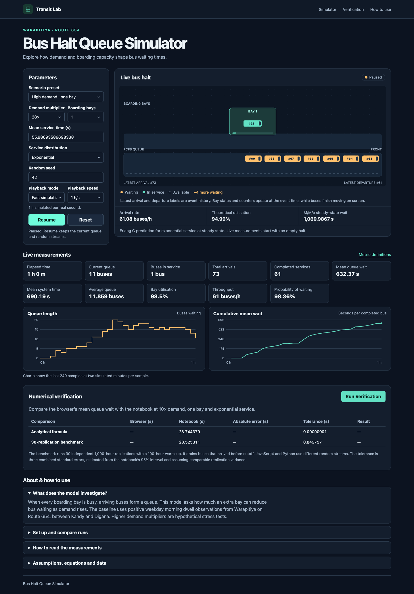
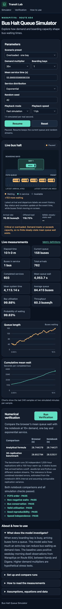
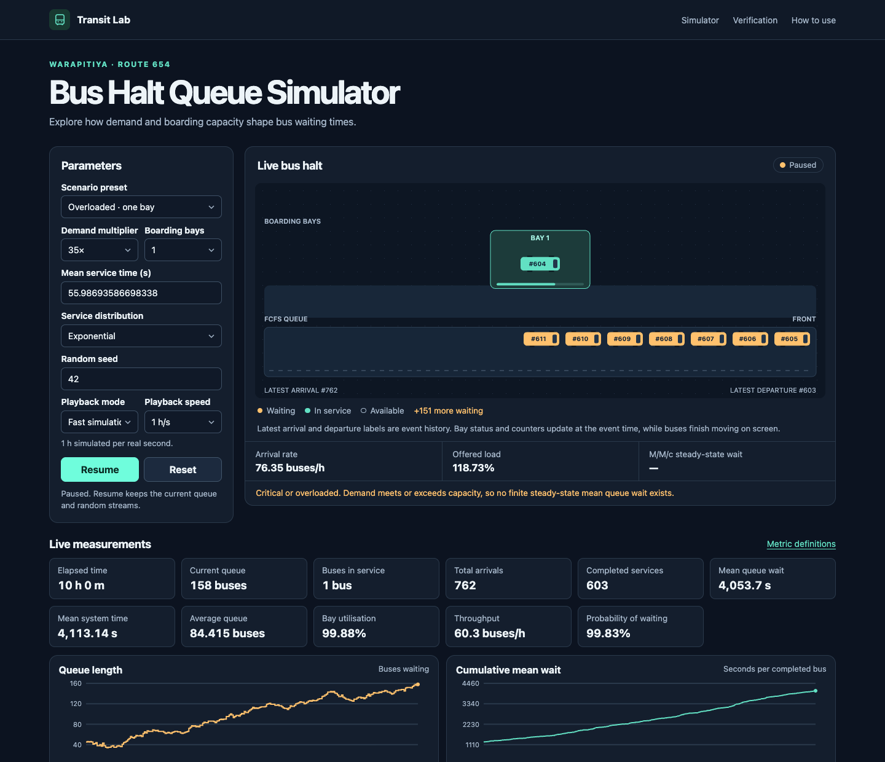
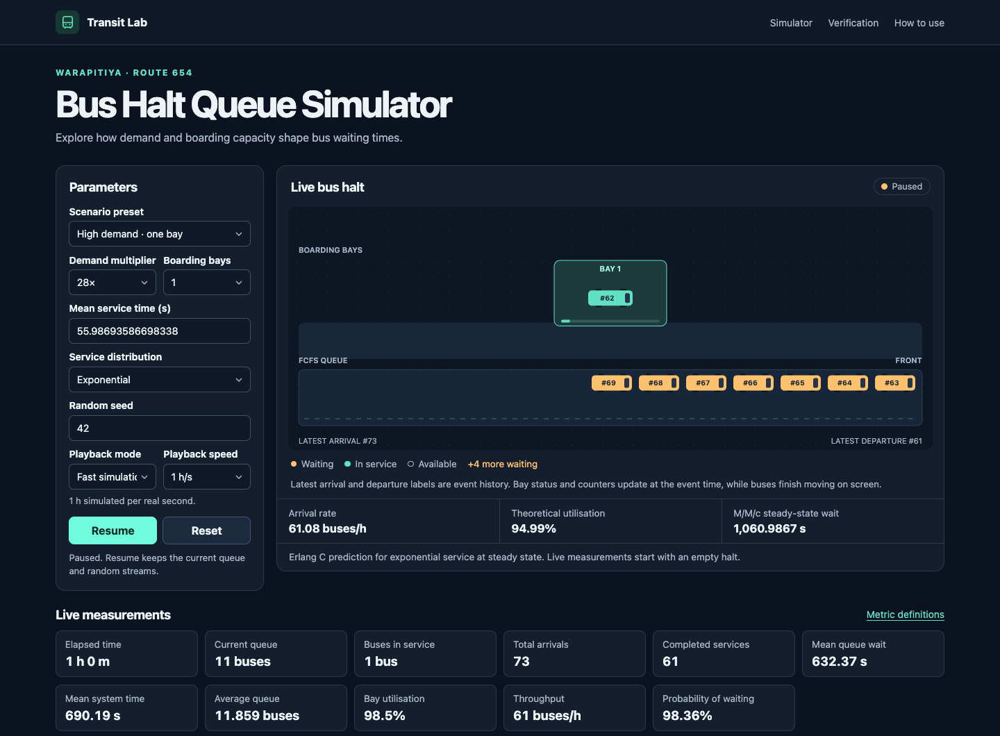
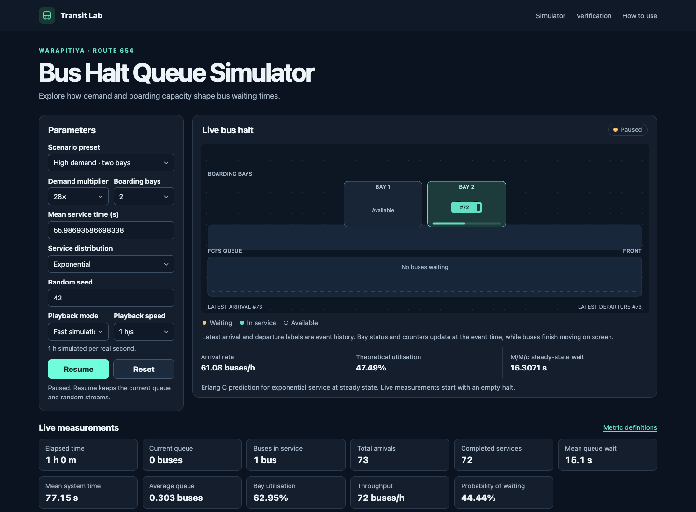
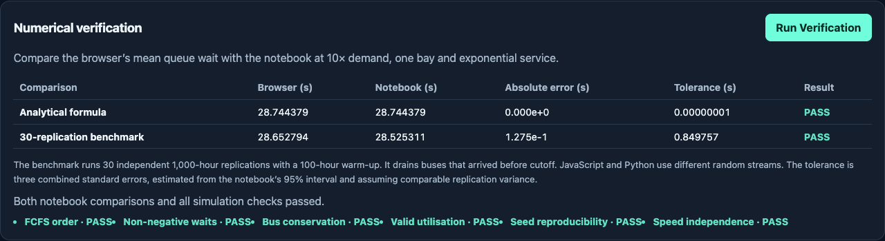

# Bus Halt Queue Simulator user guide

## Open the demo

Download or clone the repository and double-click `docs/index.html`. Keep [the HTML file](docs/index.html), stylesheet and script together in `docs/`. The simulation runs offline in your browser without installation or a server. After deployment, the same page will be available at the [planned GitHub Pages address](https://sandalika-gunawardhana.github.io/bus-halt-queue-simulator/). Hosting is pending.

## Set the controls

| Control | What it changes |
|---|---|
| Scenario preset | Loads observed baseline, high demand with one, two or three bays, or the overloaded one-bay case. Presets restore calibrated mean service and exponential service and retain your seed. |
| Demand multiplier | Scales the calibrated rate of about 2.18 buses/hour by 1×, 4×, 10×, 20×, 28× or 35×. The higher settings are hypothetical stress tests. |
| Boarding bays | Sets one, two or three identical boarding positions served by the same queue. |
| Mean service time | Average time a bus occupies a bay, in seconds. The calibrated value is about 55.99 s. The input accepts 1–600 s. |
| Service distribution | Selects exponential or lognormal service. Both use the entered mean, with different variability. |
| Random seed | Sets the repeatable random streams. Use an integer from 0 to 4,294,967,295. The default is 42. |
| Visual playback | Offers 1×, 10×, 30× and 60× simulated seconds per real second. Try **10× or 30×** to watch the buses move. |
| Fast simulation | Offers 5 or 15 simulated minutes, or 1, 4 or 12 simulated hours per real second. Use it for longer experiments. |

**Start** begins from an empty halt. **Pause** freezes simulated time and movement. **Resume** continues the same queue and random streams. **Reset** clears the run and charts while retaining the current settings. Changing a model setting or seed resets the run. Playback mode and speed can change during a run.

## Follow the buses

Amber buses wait in a shared first-come, first-served queue, with the front at the right. Teal marks a bus in service and its occupied bay. The teal progress bar shows the completed fraction of that bus’s simulated service time. Empty bays are labelled **Available**. A bus keeps its ID throughout its journey.

Only the front of a long queue is drawn. **+N more waiting** counts the extra buses, and **Current queue** includes them. Latest arrival and departure IDs are event history. The model updates bay occupancy and counters at the actual event time while the canvas finishes moving the bus. Fast simulation and reduced-motion preferences show the latest state without replaying intermediate movements.

## Read the numbers

| Measurement | Meaning |
|---|---|
| Elapsed time | Simulated time since the run began. |
| Current queue / buses in service | Counts of waiting buses and buses occupying bays. |
| Total arrivals / completed services | Counts of buses that entered and completed service. |
| Mean queue wait (s) | Average time from arrival to service start for completed buses. |
| Mean system time (s) | Average time from arrival to departure for completed buses. |
| Average queue (buses) | Time-weighted number of waiting buses since the start. |
| Bay utilisation (%) | Occupied bay-time divided by available bay-time since the start. |
| Throughput (buses/h) | Completed services per simulated hour. |
| Probability of waiting (%) | Fraction of completed buses that had a positive wait. |

The charts show recent queue length and cumulative mean wait against simulated hours. Each retains the last 240 samples, spaced two simulated minutes apart. A dash indicates an unavailable value, for example mean wait before the first completion. The live run includes the initial empty period. All waiting metrics concern buses.

The theory panel reports offered demand relative to capacity. For stable exponential service it also displays the Erlang C steady-state mean queue wait. At 100% offered load or higher, the warning appears because no finite steady-state wait is available. The lognormal option leaves the M/M/c wait blank. See [the equations](THEORY.md#queueing-equations).

## Try these scenarios

| Scenario | What to look for |
|---|---|
| A. Observed baseline | One bay has low average utilisation and waits are infrequent. |
| B. 28× demand, one bay | The bay has little idle time and waits can grow substantially. |
| C. 28× demand, two bays | Compare mean wait and occupancy against the one-bay run. |
| D. 28× demand, three bays | Compare additional waiting-time reduction and utilisation per bay. |
| E. 35× demand, one bay | Offered load exceeds capacity. Watch the queue over several simulated hours. |
| F. Exponential versus lognormal service | Try 28× with two bays. Hold the mean service time fixed and change only the distribution. |

For B–D keep demand, service mean, distribution, seed and elapsed simulated duration the same. The paired screenshots below use the exact calibrated mean, exponential service, seed 42 and one simulated hour. These snapshots illustrate individual runs. Use the notebook’s repeated experiments and intervals when comparing expected performance. For F keep demand, bay count, seed, mean duration and elapsed simulated time fixed.

## Run numerical verification

Choose **Run Verification**. The check uses a fixed 10× demand, one-bay exponential case independently of the current live settings. The analytical mean wait is **28.744379 s**. The 30-replication browser benchmark is **28.652794 s** against the notebook’s **28.525311 s**, within the **0.849757 s** tolerance. The page also reports FCFS order, non-negative waits, conservation, utilisation, seed repeatability and speed independence. [Verification method](THEORY.md#verification)

## Assumptions and limits

The model uses constant demand, one FCFS queue, identical bays and independent service times. Queue space is unlimited. GPS dwell at Warapitiya is a proxy for service time. The higher-demand scenarios are hypothetical and the results have not been validated as operational forecasts. Actual halts can have changing demand, physical queue limits and interference between bays. The dataset is credited in [data provenance](data/README.md) and [References](REFERENCES.md).
